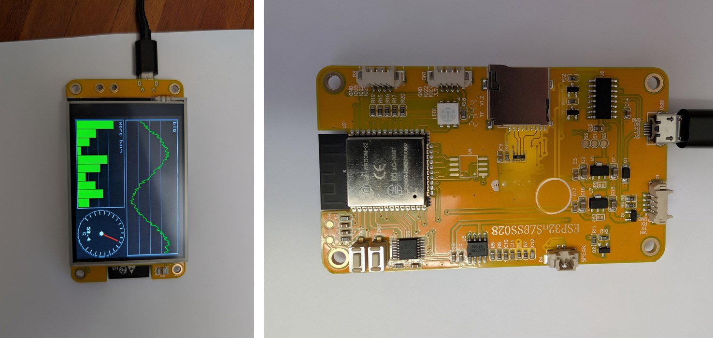

# Wattle

**Version 0.9** (first public release, pre-1.0)

A touch-screen user interface for the ESP32 **"CYD"** (*Cheap Yellow Display*: ESP32, 2.8-inch 320 x 240 ILI9341 display,
XPT2046 resistive touch) **without writing any drawing or touch code**.

You draw your screens in the **Wattle Editor**, write a short MicroPython script that says what your application *does*, and
copy both to the board. The Runtime draws the screens, watches the touch panel and calls your functions.

## Install it (Linux)

1. Plug the board into a USB port. It needs MicroPython (the installer offers to put it there if it is missing).
2. Go to the **[Releases page](https://github.com/wattle-gui/wattle/releases/latest)** and download **wattle_0.9_all.deb**.
3. Double-click it, click **Run anyway**, **Install**, enter your Linux password, then click the blue **Open** button.
4. Wait for **ALL DONE**. The board shows a small demo. A **Wattle Editor** icon appears on your Desktop.

The manual **Getting Started** explains every step with pictures. It is on the Releases page too (**Wattle_manuals_0.9.zip**: unpack it
and open `index.html`; the manuals with their videos play in your browser).

**Which systems?** Tested on **Zorin OS 18**. The package should install on other Debian-based systems that use the same package
tools (Ubuntu 22.04 or newer, Linux Mint 21 or newer, Pop!_OS 22.04 or newer, Debian 12 or newer), but we have not tried them yet.
On other Linux systems, download `Wattle-0.9.zip` from the Releases page, unpack it, and run `./install.sh` in the unpacked folder.
Windows is planned (see below).

## Free to use. Not for commercial purposes.

This software is **freeware**: a small gesture to everyone who contributed free software. You may use it, study it, change it
and share it for any **non-commercial** purpose (hobby, learning, school, research, charity). You may **not** sell it or use it
in a commercial product or service. The full terms are in [LICENSE](LICENSE) (PolyForm Noncommercial 1.0.0). Parts made by others
keep their own licences: see [THIRD_PARTY_NOTICES.md](THIRD_PARTY_NOTICES.md).

## What is where

- `Runtime.py` (and `Runtime.mpy`, the precompiled copy): the program that runs on the board. The other board files next to it are the display and touch drivers, `board_cyd.py`, `main.py` and `wifi_cipher.py`.
- `Editor/`: the design program.
- `tools/`: the helper scripts that run on your computer (`./wattle` starts them for you).
- `fonts/`, `hardware/`, `hello_demo/`: the typefaces, the list of supported hardware, and the demo that is put on the board.
- `tests/`: numbered example programs, which are also the manual's working examples.

## What you get

- 16 widgets: label, button, memo, switch, checkbox, slider, progressbar, image, line, keyboard, choice, tree,
  gauge, stepper, waveform (a moving trace, like a slow oscilloscope) and barchart
- several screens, timers, pop-up messages, saved settings, landscape and portrait
- six typefaces (Arial, Times New Roman, Comic Sans MS and three DejaVu fonts, in free look-alike versions), pictures
- screen brightness, screen saver, the BOOT button as a power button
- Wi-Fi and the real time from the internet (NTP)
- error messages on the display, and a checker that explains syntax errors and misspelt names
- a low-power mode for battery use
- numbered tests (`tests/`) that double as the manual's working examples, and a record of the results (`tests/RESULTS.md`)

## The manuals

Three manuals, as web pages with pictures and videos (download **Wattle_manuals_0.9.zip** from the Releases page):

- **Getting Started**: everything needed to install Wattle, design your screens in the Editor and write your script.
- **Reference Manual**: every property of every widget, the design file in full, the tools, the hardware, and the test results.
- **Just in Case**: the installation details and extra help.

The technical reference for the internals is `SYSTEM_README.md`.

## What comes next

This is the first release (version 0.9). It is made for the CYD 2.8" (ESP32, ILI9341 display, XPT2046 touch). A Windows version of the
installer and tools is planned. How it develops further depends on whether people find it useful.

## Credits

Created by **Bob Stanton** together with **Claude** (Claude Code, by Anthropic).
Thanks to the authors of MicroPython, mpremote, esptool, Pillow, PyQt6 and the font projects listed in
[THIRD_PARTY_NOTICES.md](THIRD_PARTY_NOTICES.md), and to everybody who shares software freely.

## No warranty

The software is provided as it is, without any warranty (see the licence). Use it at your own risk.
